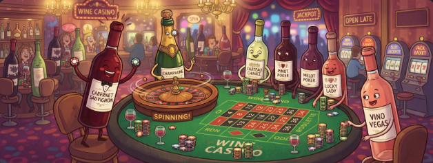
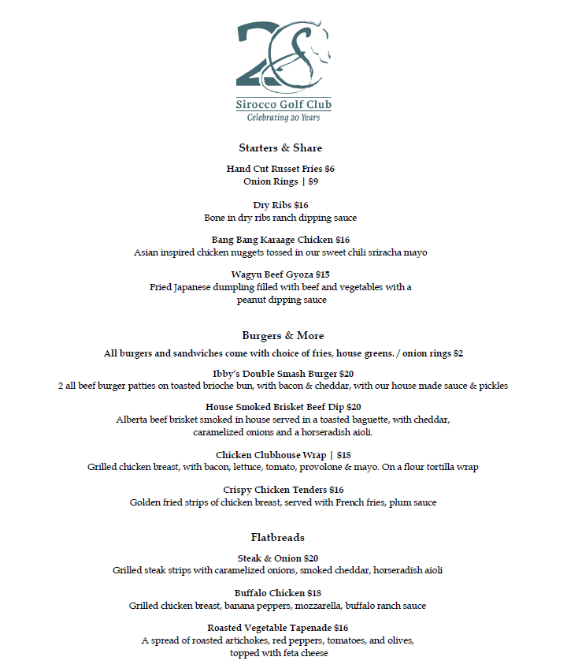

---

title: Mackey Wine Draw
layout: default
description: Like Competitions? Like Wine? Like supporting a Good Cause? Then this is for you! Come join us at Sirocco Golf Course for a Holiday party and wine draw.

---

	

		

			

				

					

						<section aria-labelledby="entry">
							
Like Competitions? Like Wine? Like supporting a Good Cause? Then this is for you! Come join us at Sirocco Golf Course for a Holiday party and wine draw.

							
							
How it works:

							
Each participant will be put on a team. Every day between Nov 21 and 27, we will draw names to eliminate participants. If your team still has participants, you are still in the draw. On Nov 28, we will draw the remaining names in person at the party, until one name remains. That person's team wins all the wine.

							
Entry fees are $30 per person. Approximately 25% of the entry goes to the food bank and 75% goes toward purchasing wine.

							
We will have a food hamper and cash box at the wine draw if you want to provide the Food Bank with more support. In 2025, we raised over $2,500 in cash and food.

							
If you intend to enter the draw or attend the party, please register at the link below

							<a class="btn btn-primary m-4" href="https://forms.cloud.microsoft/Pages/ResponsePage.aspx?id=DQSIkWdsW0yxEjajBLZtrQAAAAAAAAAAAAN__sSQ_vxUMVBFSEI0NVJRSFRRVEswRERLUkVHRTRWWi4u">Register Here</a>
						</section>
					

				

			

		

	

	

		

			

				

					

						<h4>Rules</h4>
					

					

						<section aria-labelledby="entry">
							<h3 id="entry">Entry</h3>
							
$30 - Each participant chips in a $30 entry fee and will be <strong>randomly assigned</strong> to a team.

						</section>
						<section aria-labelledby="rules" style="margin-top:12px">
							<h3 id="rules">The Game</h3>
							<ul>
								<li>Your fate is tied to your teammates - as long as <em>someone</em> from your team hasn’t been drawn, you’re still in the running for an equal share of the wine.</li>
								<li>A week before the party we start pulling names from the hat - <strong>50% of the names</strong> will be drawn before the big night.</li>
								<li>The remaining names will be drawn live throughout the evening, with the <strong>final name</strong> revealed around <strong>11:00 PM</strong>.</li>
								<li>The last name left in the drum represents the <strong>winning team</strong> - if one of your teammates is still standing, so are you.</li>
								<li>The winning team splits the wine amongst themselves.</li>
							</ul>
						</section>
					

				

			

		

	

	

		

			

				

					<h2>Holiday Party</h2>
					

				

			

		

		

			

				

					

						Saturday, November 28, 2026 
						6:00 PM 
						Sirocco Golf Club 
						210178 64 St W, Alberta 
					

					

						<h3>Food Bank</h3>
						
This year, we're once again proud to support The Calgary Food Bank. A donation box will be available at the event for non-perishable food items. If you forget to bring food, there will also be a cash donation box provided by The Calgary Food Bank.

						
Additionally, approximately 25% of your entry fee will go directly to the Food Bank, while 75% will be used to purchase wine for the draw. Last year, we raised over $2,500 in cash and food donations!

						
The runner-up in the wine-draw will receive the donation receipt for tax purposes.

						<h3>Schedule of Events</h3>
						<ul style="list-style: none;">
							<li>6:00pm Party Starts</li>
							<li>7:00pm Wine Draw Begins</li>
							<li>9:00pm Kitchen Closes</li>
							<li>11:00pm Winner is Announced</li>
							<li>1:00am Bar Closes</li>
						</ul>
					

				

			

			

				<iframe src="https://www.google.com/maps/embed?pb=!1m18!1m12!1m3!1d2519.048568262086!2d-114.08433708425419!3d50.848784879532325!2m3!1f0!2f0!3f0!3m2!1i1024!2i768!4f13.1!3m3!1m2!1s0x53719e330614e421%3A0x21753248424fdb59!2sSirocco%20Golf%20Club!5e0!3m2!1sen!2sca!4v1638482905005!5m2!1sen!2sca" width="100%" height="450" style="border:0;" allowfullscreen="" loading="lazy"></iframe>
			

			

				

					
Sirocco Menu

					

						
Gluten free and vegan options will be available.

						
						 
						<a class="h3 card-title stretched-link" href="images/siroccomenu.pdf" target="_blank" style="color: darkred;text-decoration: underline;">Download Menu</a>
					

				

			

		

	
